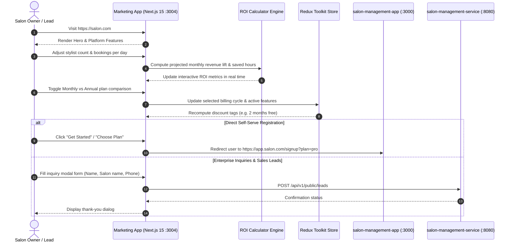

# ZenMonk Salon Platform — Marketing Website (`salon-marketing-app`)

The official public-facing B2B marketing website for the ZenMonk Salon Management Platform (`salon.com`). Designed for high customer acquisition, highlighting platform capabilities, interactive ROI simulation, SaaS subscription tiers, and conversion funnels for salon owners.

---

## 1. Problem Statement

Attracting modern salon owners to adopt a digital management platform requires clear value articulation and low onboarding friction:
- **Value Demonstration:** Salon businesses often hesitate to adopt software without understanding tangible return on investment (time saved, walk-ins converted, no-show reduction).
- **Plan Clarity:** Owners need transparent, feature-by-feature comparisons between starter and enterprise tiers.
- **Seamless Lead Conversion:** Prospects need direct funnels to register their salon immediately or submit sales inquiries for custom multi-branch setups.

**`salon-marketing-app`** solves this by delivering an optimized, engaging marketing front door equipped with an interactive ROI calculator, dynamic pricing grid, product highlights, and direct redirects to the self-serve onboarding portal.

---

## 2. High-Level Functional Architecture & Funnel Flow



---

## 3. Tech Stack

- **Framework:** Next.js 15 (Turbopack, App Router)
- **Language:** TypeScript
- **Styling:** Tailwind CSS v4, `@tailwindcss/postcss`
- **State Management:** Redux Toolkit (`@reduxjs/toolkit`, `react-redux`)
- **Forms & Validation:** React Hook Form + Zod
- **Icons & Typography:** Lucide React, Inter Variable Font
- **HTTP Client:** Axios

---

## 4. Setup & Running the Application

### Prerequisites
- Node.js (>= 18.0.0) and npm (for local runs)
- Docker & Docker Compose (for Docker runs)
- Shared Docker network created (for Docker setups):
  ```bash
  docker network create salon_management_shared_network 2>/dev/null || true
  ```

### Environment Configuration
Copy `.env.example` to `.env`:
```bash
cp .env.example .env
```
Key configuration parameters:
```env
PORT=3004
APP_FORWARD_PORT=3004
VITE_BACKEND_URL=http://localhost:8080
VITE_MANAGEMENT_APP_URL=http://localhost:3000
VITE_STOREFRONT_DOMAIN=salon.com
VITE_STOREFRONT_URL=http://localhost:3001
VITE_APP_NAME=Veloura
```

---

### Running with Docker

#### A. Development Mode (via Docker Compose)
The project includes a `Dockerfile.dev` with live source-code mounting and hot reload:

```bash
# 1. Build and start the container in development mode
docker compose up -d --build

# 2. Check container logs
docker compose logs -f app

# 3. Stop container
docker compose down
```

#### B. Production Mode (Standalone Multi-Stage Next.js Build)
The production `Dockerfile` uses a multi-stage Next.js standalone runner:

```bash
# 1. Build the production image
docker build -t salon-marketing-app:prod .

# 2. Run the production container on port 3004
docker run -d \
  --name salon-marketing-app-prod \
  --network salon_management_shared_network \
  -p 3004:3004 \
  --env-file .env \
  salon-marketing-app:prod

# 3. View Next.js standalone server logs
docker logs -f salon-marketing-app-prod

# 4. Stop and remove container
docker stop salon-marketing-app-prod && docker rm salon-marketing-app-prod
```

---

### Running Locally on Host Machine

#### A. Development Mode
```bash
# Install dependencies
npm install

# Start Next.js development server with Turbopack on port 3004
npm run dev
```
Open `http://localhost:3004` to view the marketing site.

#### B. Production Build & Start
```bash
# Lint codebase
npm run lint

# Build standalone Next.js production bundle
npm run build

# Start production server
npm run start
```
